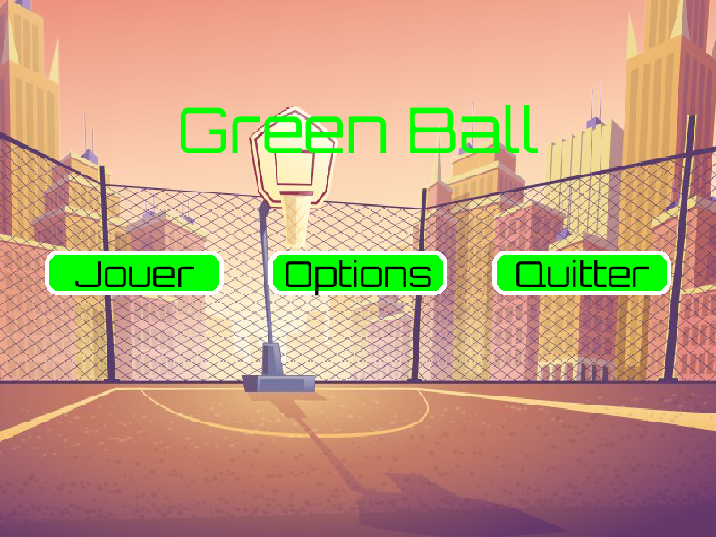
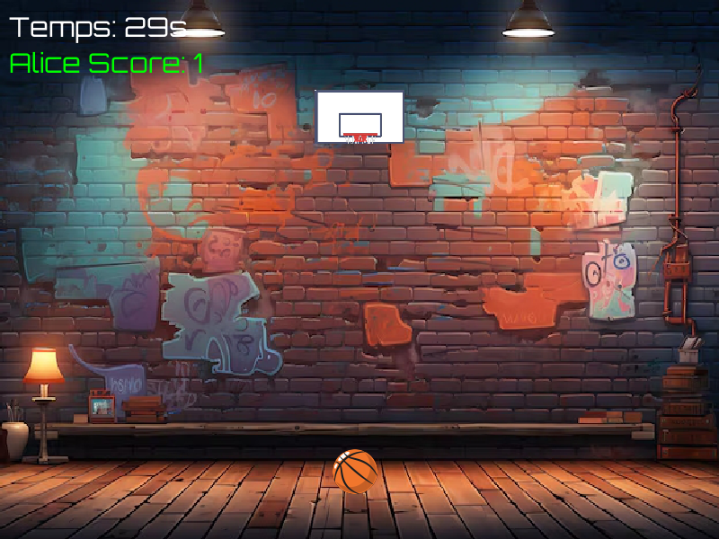

# Green Ball

Jeu de basket en 2D réalisé en équipe avec Python et Pygame. Deux joueurs jouent à tour de rôle pendant trois manches. Chaque passage dure 30 secondes ; le but est de marquer le plus de paniers.

## Aperçu

Captures du jeu avec les ressources du projet : le menu, puis une manche. Les noms et le score sont des données de démonstration.





## Installation

Installer Python 3.10 ou plus récent, puis ouvrir un terminal dans le dossier du jeu :

```sh
python -m venv .venv
```

Activer l'environnement : `.venv\Scripts\activate` sous Windows, ou `source .venv/bin/activate` sous Linux/macOS.

```sh
python -m pip install -r requirements.txt
python main.py
```

Conserver le dossier `assets/` à côté de `main.py` : il contient les images, les polices et la musique utilisées par le jeu. Le jeu nécessite une interface graphique. Si aucun périphérique audio n’est disponible, il démarre sans musique.

## Commandes

- Cliquer sur **Jouer**, puis saisir les noms des deux joueurs.
- Choisir la difficulté et le volume dans **Options**.
- Maintenir le bouton de la souris, déplacer la souris puis relâcher pour tirer. La direction du tir est opposée au déplacement, comme un lancer au lance-pierre.
- Appuyer sur **P** pour mettre la manche en pause ou la reprendre.
- À la fin, cliquer pour revenir au menu.

## Organisation

```text
projet-transverse/
├── main.py
├── assets/
├── requirements.txt
├── README.md
└── .gitignore
```

`main.py` contient le menu, les options, les animations, les manches et l'écran de fin. Les anciens scripts d'essai et les ressources non utilisées ont été retirés de la version courante ; ils restent consultables dans l'historique Git.

## Répartition du travail

- Sébastien Ramirez : menu.
- Scott Ngoumela : animations du menu.
- Hasan Ayintapli : animations du jeu.
- Aliyane Benchehida : fin du jeu et assemblage principal.
- Raphaël Derobien : jeu.

Cette répartition reprend la présentation initiale de l'équipe.

## À connaître

Les trajectoires utilisent une vitesse et une gravité mises à jour à chaque image. Le score repose sur une collision avec la zone du panier. Le mode difficile déplace le panier et change la position de départ de la balle.

Le projet reste un jeu de cours : les collisions sont simples, les animations utilisent des pauses courtes qui laissent la fenêtre répondre, et les scores ne sont pas enregistrés entre deux parties. Les corrections de démarrage conservent le déroulement et les visuels d'origine : chemin des ressources, police présente dans le dépôt, difficulté cohérente et chronomètre pendant la pause.
